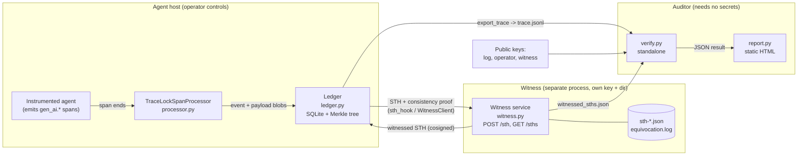
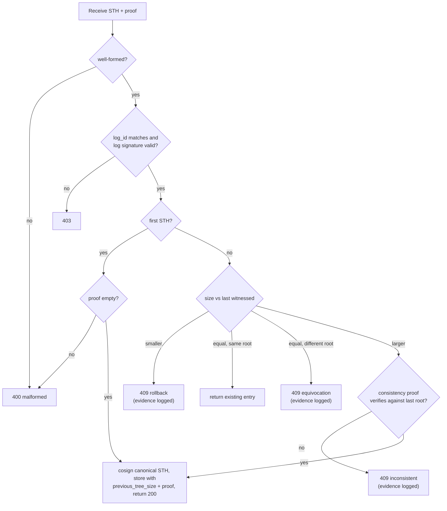

# TraceLock Architecture

TraceLock is a tamper-evident accountability layer for AI agents. It records an agent's
`gen_ai.*` OpenTelemetry spans in a signed Merkle-tree ledger (RFC 6962 / Certificate
Transparency style), has an independent **witness** cosign the ledger's tree heads, and lets an
auditor check the history with a **standalone verifier** that shares no code with the recorder.

> **Claim.** Given only an exported trace, public keys and independently witnessed tree heads,
> an auditor can detect edits, deletions and rewrites of an agent's history **up to the last
> witnessed checkpoint**, with low per-event overhead.

---

## 1. Goals and non-goals

| Goal | How it is met |
|---|---|
| Detect edited events | Every event is signed (operator key) and is a Merkle leaf |
| Detect deleted / reordered events | Ledger-assigned `seq` is inside the signed leaf; Merkle root changes |
| Detect a full history rewrite by the log operator | A separate witness holds earlier tree heads and refuses forks |
| Let payloads be redacted without breaking proofs | Leaves hold only payload *hashes*; raw payloads live in a separate table |
| Be auditable by an outsider | Verifier needs only the trace, public keys and witnessed STHs |

**Non-goals** (stated honestly in the README): proving the agent was truthful; recording actions
that bypass instrumentation; protecting events after the last witnessed checkpoint; real witness
independence on one machine; multi-witness quorum, key rotation, dashboards.

---

## 2. System overview

Three parties, with two trust boundaries. The recorder and the witness are separate processes
with separate keys and storage; the verifier runs anywhere.



**Trust boundaries**

1. *Operator -> witness.* The operator controls the agent, the ledger and the log/operator keys.
   The witness is the independent party; its signature is what the operator cannot forge.
2. *Evidence -> auditor.* The auditor trusts only public keys obtained out of band and the
   mathematics. The trace and the witnessed STH file are untrusted inputs.

---

## 3. Components

| Module | Responsibility | Depends on |
|---|---|---|
| `canonical.py` | Deterministic JSON (sorted keys, `(",",":")`, UTF-8, **no floats**), SHA-256 | stdlib |
| `merkle.py` | RFC 6962 tree: append, root, historical root, inclusion/consistency proofs, verify functions | stdlib |
| `signing.py` | Ed25519 keygen, sign, verify, hex/PEM load and save (private keys saved `0600`) | `cryptography` |
| `ledger.py` | SQLite store, `seq` assignment, leaf signing, STH issuance, rebuild, trace export, STH hook | canonical, merkle, signing |
| `processor.py` | OTel `SpanProcessor`: span -> event, whitelist, redaction, payload hashing | ledger, canonical, OTel SDK |
| `witness.py` | Witness core, HTTP service, `WitnessClient`, file-witness CLI | canonical, merkle, signing |
| `verify.py` | **Standalone** verifier CLI (own copy of canonical JSON and RFC 6962 verify) | stdlib + `cryptography` only |
| `report.py` | Static HTML from verifier JSON (inline CSS, no JS) | stdlib |
| `integration.py` | `setup()` / `init_keys()` convenience: keys, ledger, witness client, processor in one call. Loaded lazily so `import tracelock` never imports OpenTelemetry | ledger, processor, witness, signing |
| `demo/*` | Scripted and Groq agents, shared mock tools, fixtures, `run_all` | tracelock |
| `attacks/tamper.py` | Six tamper scenarios on copies of artifacts, results table | demo, tracelock |
| `bench/overhead.py` | Per-span overhead microbenchmark | demo, tracelock |

The dependency rule that matters: **`verify.py` imports nothing from the `tracelock` package.**
A test parses its imports (AST) and requires only the standard library and `cryptography`, and
cross-checks its RFC 6962 copy against `merkle.py` for every inclusion and consistency case up to
size 32.

---

## 4. Data model

### 4.1 Event

The unit that becomes a Merkle leaf. Canonical JSON, integer-nanosecond timestamps.

| Field | Notes |
|---|---|
| `seq` | Assigned **by the ledger** at append time (0-based, equals the leaf index), never by the span |
| `trace_id`, `span_id`, `parent_span_id` | Hex strings; parent is `null` for roots |
| `name`, `status` | Span name; `UNSET` / `OK` / `ERROR` |
| `start_time_ns`, `end_time_ns` | Integers |
| `attributes` | Whitelisted `gen_ai.*` keys only, via one mapping table |
| `payload_hashes` | `{input_sha256, output_sha256}`: hex or `null` |
| `session_id` | Groups events for the `session_end` count |

### 4.2 Cryptographic objects

```text
leaf_data       = canonical_json(event)
leaf_hash       = SHA256(0x00 || leaf_data)                 # RFC 6962 leaf
node_hash       = SHA256(0x01 || left || right)             # RFC 6962 node
event_signature = Ed25519_operator( leaf_hash )

STH             = { tree_size, root_hash, timestamp_ns, log_id }
STH_signature   = Ed25519_log( canonical_json(STH) )
witnessed STH   = STH + signature + witness_id
                  + witness_signature = Ed25519_witness( canonical_json(STH) )
                  + previous_tree_size + consistency_proof[]   # stored by the witness
```

`log_id` and `witness_id` are the SHA-256 of the respective raw public key.

### 4.3 Special event: `session_end`

Appended by `Ledger.end_session(session_id)`. Its attributes commit to the number of events in
the session (`tracelock.session.event_count`, excluding itself). The ledger always issues an STH
right after it. The verifier compares the commitment with the events it actually finds.

### 4.4 SQLite schema (`ledger.db`)

```sql
events   (seq INTEGER PRIMARY KEY, session_id TEXT, leaf_data BLOB, leaf_hash BLOB, signature BLOB)
payloads (sha256 TEXT PRIMARY KEY, data BLOB)          -- separate: deletable without breaking proofs
sths     (id INTEGER PK AUTOINCREMENT, tree_size, root_hash, timestamp_ns, log_id, signature BLOB)
```

### 4.5 Exchange formats

**Trace** (`trace.jsonl`, one line per event):

```json
{"event": {...}, "signature": "<hex>", "payloads": {"<sha256>": "<text>"}}
```

`payloads` is optional. The verifier recomputes the leaf from `event`, so no hashes are trusted
from the file.

**Witnessed STHs** (`witnessed_sths.json`): a JSON array of witnessed-STH objects as in 4.2.

---

## 5. Write path

```mermaid
sequenceDiagram
    autonumber
    participant Ag as Agent
    participant Pr as TraceLockSpanProcessor
    participant Le as Ledger
    participant Db as SQLite
    participant Wc as WitnessClient
    participant Wi as Witness

    Ag->>Pr: span ends (on_end)
    Pr->>Pr: skip if no gen_ai.* attribute
    Pr->>Pr: whitelist attrs, redact payloads, hash payloads
    Pr->>Le: append(event, payload blobs)
    Le->>Le: seq = tree size; canonical_json; leaf_hash
    Le->>Le: sign leaf_hash (operator key)
    Le->>Db: one transaction: INSERT event + payloads (commit)
    Le->>Le: advance in-memory Merkle tree
    alt size % N == 0 or event is session_end
        Le->>Le: issue STH, sign (log key), persist
        Le->>Wc: sth_hook(STH)
        Wc->>Wi: POST /sth {sth, consistency_proof from last witnessed size}
        Wi->>Wi: verify log signature, then consistency proof
        Wi-->>Wc: 200 witnessed STH  (or 403 / 409)
    end
    Le-->>Pr: AppendResult(seq, leaf_hash, signature, sth?)
```

Key properties of this path:

- **Synchronous and durable.** The row is committed before `append` returns; there is no batching,
  so a crash cannot silently lose an acknowledged event. In-memory state advances only after the
  commit succeeds, so a failed append leaves no gap.
- **Ordering is by `seq`, not span time.** Spans end child-before-parent; the ledger records them
  in the order they arrive.
- **Witness failures never lose events.** A failing hook is logged and appended to
  `ledger.hook_errors`; callers should check it. (The clean-run test asserts it is empty.)
- **Thread safety.** One re-entrant lock serialises appends and STH issuance within a process.
  One ledger process per database file.

---

## 6. Merkle ledger (`merkle.py`)

- **Incremental root.** A *frontier* of perfect subtrees (like a binary counter) gives an O(log n)
  `root()` after each append.
- **Historical roots and proofs.** Computed recursively exactly as RFC 6962 sections 2.1.1-2.1.2
  (`PATH` and `SUBPROOF`); hashes of perfect subtrees are cached because leaves never change.
- **Verification.** Iterative algorithms from RFC 9162 section 2.1.3.2 and 2.1.4.2, which accept
  exactly the RFC 6962 proofs.
- **Sizes.** `consistency_proof(0, n)` and `(n, n)` are empty; the empty-tree root is `SHA256("")`.
- **A subtlety the design accounts for.** A Merkle root does not commit to its own tree size
  (sizes 12 and 13 can yield the same-shaped proof for some indices). That is why an STH signs
  `(tree_size, root_hash)` *together*, and why verifiers take both from a signed STH.

**Restart.** The tree is rebuilt from stored leaves. Rebuild is strict: it raises
`LedgerCorruptError` on a `seq` gap, a leaf-hash mismatch, a `seq` inside the leaf that differs
from its row, or a stored STH that does not match the leaves.

---

## 7. Witness (`witness.py`)

A witness has its **own key** and **own data directory** (`witness.key`, `witness.pub`,
`sth-<size>-<root>.json`, `equivocation.log`). It stores only the chain of STHs it has cosigned.

### 7.1 Protocol

| Request | Purpose |
|---|---|
| `POST /sth` body `{"sth": {tree_size, root_hash, timestamp_ns, log_id, signature}, "consistency_proof": [hex,...]}` | Submit a head with a proof from the witness's last stored head |
| `GET /sths` | All witnessed STHs (the file handed to auditors) |

### 7.2 Decision procedure



The witness stores each consistency proof with the STH it cosigns. This lets an auditor re-check
the witness's chain **without trusting or reading the trace**.

### 7.3 Client and modes

- `WitnessClient(base_url, proof_fn)` is used as `ledger.sth_hook`. It asks the witness for its last
  size once, then tracks it (single-writer assumption) and sends `proof_fn(last, new)`.
- **HTTP service:** `python -m tracelock.witness serve ...` (`demo.run_all` launches it as a real
  separate OS process).
- **File witness:** `python -m tracelock.witness cosign ...` cosigns one STH from a JSON file and
  writes one file per STH into a directory that can be a separate git repository. Both modes share
  the same core logic and storage.

---

## 8. Verifier (`verify.py`)

Inputs: `--trace`, `--log-pubkey`, `--agent-pubkey`, `--witness-pubkey` (repeatable),
`--witnessed-sths`, optional `--out`. Output: JSON on stdout. Exit code **0 PASS, 1 FAIL, 2 bad input**.

### 8.1 Checks

| Check | What it establishes | Range type |
|---|---|---|
| `trace_format` | Every line parses and canonicalises | - |
| `sth_signatures` | Each witnessed STH has a valid log signature, a matching `log_id`, and a valid signature from a supplied witness key. Invalid entries are ignored by later checks | - |
| `event_signatures` (a) | Each event verifies under the operator key | exact |
| `seq_continuity` (b) | `seq` is 0..n-1: no gaps, duplicates or reordering | exact |
| `merkle_root_vs_witnessed_sths` (c) | The root recomputed from the trace equals every witnessed STH at its `tree_size`; a trace shorter than a witnessed size fails | bound |
| `witnessed_sth_consistency` (d) | The witness's stored proofs link successive STHs; the same size with two roots (equivocation) fails. **Independent of the trace** | bound |
| `session_end_counts` (e) | Each `session_end` commitment equals the events actually found | bound |
| `payload_hashes` (f) | Payload text, where present, hashes to the committed value. Missing payloads count as "payload redacted", not tampering | exact |

If no valid witnessed STH exists, (c) and (d) **fail**: the history is not anchored to anything.

### 8.2 Result and localisation

The JSON result holds: `overall`, per-check `status/detail/ranges/failures/warnings`,
`first_broken_seq_range`, `events_checked`, `unwitnessed_tail`, a `witnessed_sths` summary, and a
per-event list (`ok`, `issues`, payload state) that `report.py` renders.

**First broken range.** *Exact* checks name specific events. *Bound* checks only say where a break
lies (for example "after the last checkpoint that matched, before this one"). The verifier reports
the earliest range and, if that is only a bound, narrows it to the earliest exact finding inside it.

### 8.3 Unwitnessed tail

Events at index >= the largest valid witnessed `tree_size` are reported as the **unwitnessed
tail**: protected only by their own signatures, so a silent truncation of them is undetectable.

---

## 9. Keys and trust

| Key | Held by | Signs | Verifier needs |
|---|---|---|---|
| Operator ("agent") key | Agent host | each leaf hash | public key |
| Log key | Agent host (ledger) | STHs | public key |
| Witness key | Witness only | canonical STH | public key(s) |

The security of the design rests on the witness key being out of the operator's reach. An attacker
holding the log and operator keys can build a perfectly self-consistent rewrite (valid signatures,
hashes and STHs) but cannot obtain witness signatures for it, and cannot make the witness forget
the earlier heads. Compromise of all three parties together defeats the scheme.

---

## 10. Payloads, redaction and the span-to-event mapping

- **Whitelist and mapping.** `processor.py` has one table, `ATTRIBUTE_MAP`, from source span
  attribute to stored key, so `gen_ai.*` name drift (the conventions are experimental) needs a
  one-place change. Older names (`prompt_tokens`, `completion_tokens`) map to current ones; the
  current name wins if both are present. Names are marked "verify against current docs".
- **Payload sources.** `INPUT_PAYLOAD_KEYS` / `OUTPUT_PAYLOAD_KEYS` list which span attributes are
  hashed as input and output; the first present wins. Hash `null` means "no payload".
- **Redaction before hashing and storage.** Bearer tokens, `gsk_` / `sk-` keys, `api_key` /
  `Authorization` pairs, sensitive field names, and the literal `GROQ_API_KEY` from the environment
  are replaced with `[REDACTED]`. The hash is of the *redacted* bytes, so secrets never reach the
  ledger, payload table, exports or fixtures. Redaction is pattern-based, not a guarantee.
- **Recording scope.** Only spans with at least one `gen_ai.*` attribute are recorded. Floats in
  attributes are stored as strings (canonical JSON forbids floats).

---

## 11. Demo, attacks and benchmark

- **`demo/agent_scripted.py`**: seeded, offline agent with three mock tools (`read_file`,
  `send_email_stub`, `calculator`), 10-20 spans per session. `produce_artifacts(...)` wires agent ->
  processor -> ledger -> witness -> export and is reused by tests, attacks and the benchmark.
- **`demo/agent_groq.py`**: tool-calling loop via the OpenAI client against Groq or OpenAI (`--provider`; keys and models from `.env`), max 10 steps,
  exponential backoff on 429/5xx, manual `gen_ai.*` spans, optional `--record` fixture.
- **`demo/run_all.py`**: starts the witness as a separate OS process, runs the pipeline, verifies,
  writes `report.html`. It refuses to wipe a directory it did not create.
- **`attacks/tamper.py`**: six scenarios on *copies* of the artifacts.

  | # | Scenario | Outcome | Mechanism |
  |---|---|---|---|
  | 1 | Edit an event | detected | signature + root |
  | 2 | Delete a mid-log event | detected | continuity + root |
  | 3 | Truncate before the last witnessed STH | detected | root vs witnessed size |
  | 4 | Truncate after the last witnessed STH | **not detected** (known limitation) | unwitnessed tail |
  | 5 | Full rewrite with log + operator keys | detected | root vs earlier witnessed STH; witness also 409s |
  | 6 | Event never emitted | **not detected** (known limitation) | bypass: nothing was recorded |

- **`bench/overhead.py`**: times each span's lifecycle excluding its body (so nested spans never
  double-count) with and without the processor, across STH intervals N = 1, 5, 20, 50 and with or
  without the witness call; reports absolute added ms at p50 / p95 / mean after warm-up.

---

## 11b. Packaging

`pyproject.toml` packages only `tracelock/` (demo, attacks and bench are repo-only) and installs three
console commands: `tracelock-verify`, `tracelock-witness`, `tracelock-report`. `tracelock/__init__.py`
exposes `setup`, `init_keys` and `TraceLock` lazily (PEP 562), so the verifier path never imports
OpenTelemetry; a test enforces this.

---

## 12. Extension points

| To change | Edit |
|---|---|
| A renamed `gen_ai.*` attribute | `ATTRIBUTE_MAP` in `processor.py` |
| Where prompts/outputs come from | `INPUT_PAYLOAD_KEYS`, `OUTPUT_PAYLOAD_KEYS` |
| Session id source | `SESSION_ID_KEYS` or `TraceLockSpanProcessor(session_id=...)` |
| Checkpoint frequency | `Ledger(sth_interval=N)` |
| One-call wiring of the above | `tracelock.setup(...)` in `integration.py` |
| Where heads are sent | `ledger.sth_hook` (any callable taking a `SignedTreeHead`) |
| Redaction rules | patterns at the top of `processor.py` |

---

## 13. Design decisions and trade-offs

| Decision | Reason | Cost |
|---|---|---|
| `seq` assigned by the ledger inside the signed leaf | Deletion and reordering become visible | The ledger must hold the operator key to sign after assigning `seq` |
| Leaves hold payload *hashes* only | Payloads can be redacted or deleted without breaking proofs | Redacted payloads cannot be verified (reported as "redacted") |
| Synchronous append, one commit per event | No silent loss on crash | About 1 ms per event dominated by SQLite commit |
| Witness stores consistency proofs | Check (d) works without the trace | Slightly larger witnessed STH file |
| Standalone verifier with its own RFC 6962 copy | An auditor needs no TraceLock code beyond one file | Duplicated logic, guarded by a cross-check test |
| First STH accepted on first use | A witness cannot validate against nothing | Initial trust in the first head |
| Checkpoint interval N | Bounds the unwitnessed tail | Smaller N costs more commits and witness calls |

---

## 14. Known limitations

1. Tamper-evidence is not truthfulness: the record shows it was not altered, not that it is accurate.
2. Actions that bypass instrumentation are not recorded.
3. Events after the last witnessed STH can be truncated silently; the checkpoint interval is the
   vulnerability window, and withholding the latest witnessed STHs only widens it.
4. A same-machine witness is a demo, not real independence; the witness endpoint is unauthenticated.
5. `gen_ai.*` conventions are experimental; versions are pinned.
6. One ledger process per database; the witness client assumes it is the only submitter.
7. Simultaneous compromise of operator, log and witness keys defeats the scheme.
